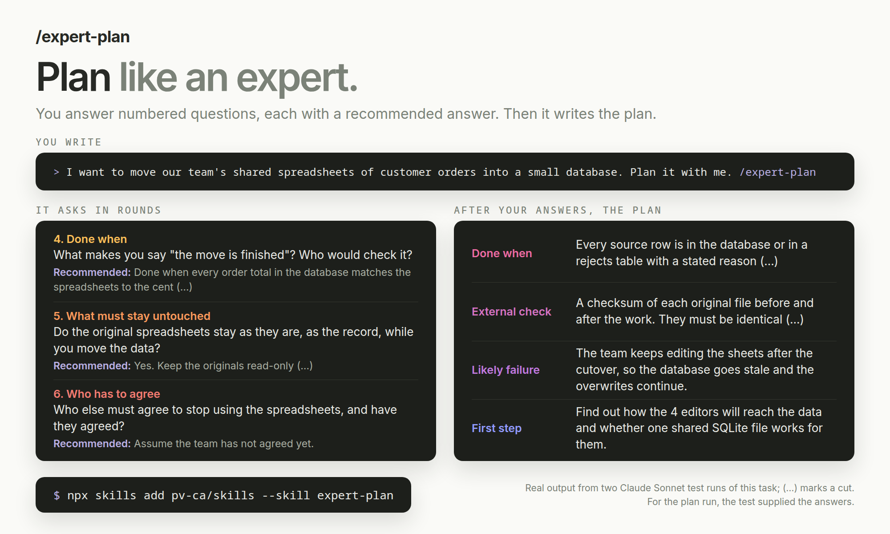

# expert-plan

Answer a few rounds of questions, get back a plan written to a top professional's standard.

This skill merges [grilling](https://github.com/mattpocock/skills) by Matt Pocock, which asks questions in rounds, with [expert](../expert/) from this collection, which writes the plan. See [Credits](#credits).

<p align="center">
  
</p>

## What it does

Add `/expert-plan` to a task and the agent holds off on the work. First it asks you questions, then it writes a plan.

The questions come in rounds. Each round holds every question that can be asked right now, so nothing depends on an answer you have not given yet. Every question is numbered and comes with:

- what your answer changes in the plan, so you can see why it is being asked;
- a recommended answer, saying what it rests on, so "yes" is a complete reply.

The agent looks up the facts it can find in your files or tools, and you make the decisions. The questions cover the things plans often fail on: what "done" means, who has to carry the work out, how long comparable work took people you know, what would make it fail, and when you would stop.

It writes the plan once you say so. The plan is one prompt you can copy into this session or another one. It names the field whose standard applies and answers nine lines for it: done when, expert moves, raw material, methods, external check, likely failure, off the table, not checked, and first step. Claims it did not verify are marked as such.

The plan sets a higher standard for the job you described, within the same goal and scope, and adds no deliverables.

## When to reach for it

Use it before work where starting in the wrong direction is expensive and part of what matters is still only in your head: a code migration, a product launch, a course, a large purchase, a study plan.

| You have | Use |
| --- | --- |
| A task you can already describe well | [expert](../expert/): rewrites it right away, no questions |
| A task with open decisions | `expert-plan` |
| An idea to pressure-test, with no plan wanted at the end | Matt Pocock's [grilling](https://github.com/mattpocock/skills) |
| A one-line fix | Nothing: just ask for it |

## Install

With the [`skills` CLI](https://github.com/vercel-labs/skills), which works with most agents:

```bash
npx skills add pv-ca/skills --skill expert-plan
```

To update: `npx skills update`. Other ways to install are in the [collection's README](../../README.md#install). It works on its own, with nothing to set up.

## How to use it

1. Type your task and add `/expert-plan` anywhere in the message, usually at the end. A message holding only `/expert-plan` plans your previous request. Attach the files that matter.
2. Answer by number: `1: yes. 2: no, the deadline is in March. 3: I don't know.` Or `yes to all`, which accepts every recommendation, defaults included.
3. When it says it has what it needs, ask it to write the plan.
4. Read the plan, correct what is wrong, then tell the agent to run it or paste it into a new session.

To get a good plan:

- Push back when a recommendation is wrong. If you answer "yes to all" every round without reading, the agent ends up making your decisions.
- Say "I don't know" when you don't. The plan then carries an assumption that its first step checks.
- Correct a question when it misses the point. The next round is rebuilt from your answers.
- Start in a fresh conversation with plan mode off, so earlier plans do not steer the questions and the agent is not pushed to finish early.
- Use a strong model if you can choose. The quality of the questions depends on it.

## Common questions

**How many rounds will it take?** As many as there are decisions that depend on earlier answers. The last one sketches the plan and asks how it could fail, when you would stop, and what would most make it work. If you want it shorter, tell it to wrap up.

**Will it start doing the work?** No. Calling the skill asks for questions and a plan. It may read files to find facts, and it waits for your go-ahead before writing the plan.

**Can I answer in my own language?** The rounds are written to follow your language. It has been tried in English and Portuguese.

## Example

You type:

```text
I want to launch a short online photography course for beginners, my first one. /expert-plan
```

The first round asks seven numbered questions. One of them (shortened; the whole conversation, four turns, is in [example.md](example.md)):

> **7. The question that could sink it**
>
> Has anyone, other than friends and family, ever asked you to teach them photography or asked how you take your photos? If so, what did they ask in their own words?
>
> *How this changes the plan:* If people have asked, the plan builds the course around their actual questions. If no one has, the first step is to find out whether any beginner would pay before you film anything.

After two rounds of answers and a "yes, write it", the plan says, among other lines:

> **Likely failure:** [...] The likeliest cause is that followers like the posts but won't pay. Kill criterion: if by 2027-01-17 fewer than 60 people have joined the waitlist, stop and re-plan before filming anything.
>
> **First step:** This week, make a one-page waitlist on a platform plan that fits $150 and publish one free Instagram post answering "how do you get the background blurry" with the waitlist link.

## It's working if

- Questions arrive in numbered rounds, later ones building on your answers, and you can reply to a whole round by number.
- It does not ask what your files already answer.
- It never invents an answer for you. For a fact only you know, it recommends what you said, what it found, or a default marked as one.
- The plan appears only after you confirm, and its external check does not depend on you or the model saying it went well.

It is not working if the agent starts editing files, asks everything at once with no recommendations, or writes a plan that would read the same for any other task.

Known limits, seen in testing:

- Some numbers still bundle two decisions. Answer each part, for example `3: yes to the date, no to the budget`.
- Some recommendations add a second choice ("yes, and also..."). Accept only the part you want.
- In some test runs the reply came in Portuguese to an English message. If that happens, ask for English.

## Tests

[evals.json](evals.json) holds the cases: a first round over a real file, a first round in Portuguese, the last round, the confirmation before writing, a plan from finished rounds, and a question about planning that must not fire the skill. Run them with `python3 scripts/eval.py expert-plan`. Results are in [CHANGELOG.md](../../CHANGELOG.md).

## Credits

The rounds of questions come from the `grilling` skill by [Matt Pocock](https://github.com/mattpocock/skills) (MIT, [notice](THIRD-PARTY.md)). The plan format comes from [expert](../expert/), inspired by a prompt shared by Felix Rieseberg and DannyMac180's `be-ambitious` skill. The questioning also draws on assumption mapping (Bland and Osterwalder), value of information (Howard), asking about past behavior (Fitzpatrick), *Decision Quality* (Spetzler, Winter and Meyer), reversibility and kill criteria (Annie Duke), the outside view (Kahneman and Lovallo) and the premortem (Gary Klein).
